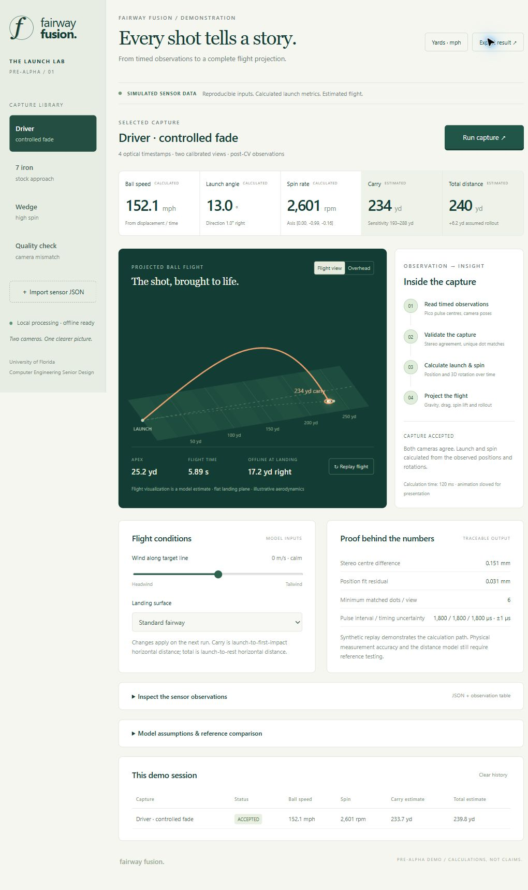

# Pre-alpha stakeholder demonstration

Branch: `pre-alpha-stakeholder-demo` (built on `asymmetric-dot-spin-tracking`).

## Start

On this Windows checkout, double-click `Start-Demo.cmd`. Keep its terminal open during
the demo; Ctrl+C stops the server. The browser opens after the server starts.
The dashboard runs at http://127.0.0.1:8765 and requires no internet,
account, camera hardware, external fonts, frontend build, or cloud service.



On a fresh machine with Python 3.10+:

```powershell
cd C:\Design\fairway-fusion
python -m venv .venv
.venv\Scripts\python.exe -m pip install -e ".[dev]"
.venv\Scripts\python.exe -m fairway_fusion.demo.server
```

On Linux/macOS use `.venv/bin/python` instead. After installation the equivalent
command is `fairway-demo`. Use `--port 8766` if 8765 is occupied, then open that port.
The development server binds to loopback only; it is not an internet deployment.

## Five-minute presentation

1. **Introduce the boundary.** The library contains simulated calibrated camera
   observations, after the computer-vision stage. The prior image pipeline remains
   available separately. This dashboard does not pretend to be a live camera feed.
2. **Run the driver.** Click Run capture. Explain the four stages: read Pico timing,
   check stereo/dot quality, calculate launch and spin, project the flight.
   Presentation transitions are deliberately paced; actual calculation time appears
   below the quality result. Metrics are computed by the Python server, not preset UI values.
3. **Inspect the result.** Show speed, launch angle, spin, carry, total, apex, flight
   time and lateral landing offset. Replay the flight and switch to Overhead.
4. **Explain evidence.** Expand sensor observations for the timestamp/position table
   and full JSON. Expand assumptions/reference comparison to compare recovered launch
   values with the independent synthetic truth. Reference values never go to the solver.
5. **Compare shots.** Run the iron and wedge. Session history keeps up to 50 results
   in this tab. Switching units also updates the history. Change wind or surface and
   rerun a capture to show model sensitivity without changing the observed launch.
6. **Show a failure.** Run Quality check. One camera has an injected 15 mm position
   error; the capture is rejected and launch/spin/distance cards remain unavailable.
7. **Show the integration path.** Download a sensor JSON, import it again and run it.
   Export result saves input, output, exact model conditions, and the independent
   synthetic reference when available. Nothing is uploaded outside localhost.

## What the numbers mean

| Output | Calculation | Evidence status |
| --- | --- | --- |
| Speed / launch / direction | Least-squares 3D positions versus optical pulse times | Calculated from supplied observations |
| Spin rate / 3D axis | Relative orientation matrices divided by each pulse interval | Calculated from supplied observations |
| Carry / apex / flight time / offline | Numerical flight integration | Model estimate, not measured flight |
| Roll / total | Effective landing-speed fraction plus constant surface deceleration | Surface assumption; not a bounce simulation |

Accepted inputs pass timing/alias bounds, two-camera centre and orientation agreement,
dot count/residual/uniqueness, constant-motion residual and spin consistency checks.
These diagnostics are not calibrated probabilities. Synthetic fixtures are seeded
and include small position/orientation noise. They do not establish hardware accuracy.
The timestamp interval is 1,800 µs; each synthetic view contains six matched dots.

## Sensor JSON contract, version 1

Use **Download input JSON** for an exact working file, or generate all four examples:

```sh
python scripts/export_demo_inputs.py examples/demo
```

Top-level fields: `schema_version: 1`, `shot_id`, `label`, `source` (`synthetic` or
`recorded`), `timing`, two `cameras`, and 3–16 `observations`.

- `timing.verified`: caller assertion that optical timing and frame association are
  qualified. `uncertainty_us`: finite bound from 0 through 10 µs. For recorded data,
  establish this with actual bench measurements, never host USB receipt times.
- Camera `R` is a proper world-to-camera rotation. `t_m` is its translation in metres:
  `point_camera = R @ point_world + t_m`.
- Each observation has an increasing `timestamp_us` and two `views` in camera order.
- A view supplies `center_camera_m`, `ball_to_camera` (proper 3x3 rotation mapping the
  SAME ball-fixed reference into that camera), `matched_dots` (4–16),
  `orientation_residual_rad` (0–0.055) and `pattern_unique: true`.
- Both cameras and every pulse must use the same ball reference. Relative rotations
  alone from the earlier matcher must be accumulated consistently before supplying
  these absolute orientations. An adapter from raw images is not part of this demo.
- World axes: +X downrange, +Y left, +Z up. Positive lateral offset means left.
  Changing `source` to recorded does not prove provenance; the UI says so explicitly.

The API is `GET /api/fixtures`, `GET /api/fixtures/{id}`, and `POST /api/replay` with
`{"capture": <sensor packet>, "conditions": <optional model settings>}`. Invalid
JSON/schema returns HTTP 400; a well-formed capture failing quality returns HTTP 200
with `status: rejected`, reasons and null metrics. Import limit is 1 MB. Files are
processed in memory; history is tab-local and disappears on refresh.

## Flight model and accuracy limits

`analysis/flight.py` integrates a point mass with gravity, quadratic drag and lift
along `omega × air_relative_velocity`, using SciPy's adaptive ODE solver until the
ball returns to the launch-height plane. Ball radius 0.021335 m, mass 0.04593 kg,
gravity 9.80665 m/s². Defaults: density 1.225 kg/m³, Cd 0.25, lift coefficient
`min(0.32, 1.4 * radius * |omega × v_air| / |v_air|²)`, exponential spin decay 25 s.
These aerodynamic coefficients are illustrative assumptions, NOT a validated fit.

Carry is the horizontal distance to first impact. Effective ground speed is landing
horizontal speed times a surface factor; roll distance is ground-speed²/(2*deceleration).
Total is horizontal launch-to-rest distance. Surface factor / deceleration values:
soft 0.12 / 3.5 m/s²; standard 0.22 / 2.5; firm 0.30 / 2.0. They are illustrative
rollout settings; turf, slope, bounce, friction and spin interaction are not resolved.

The displayed carry sensitivity range varies Cd and lift slope independently by ±20%.
It excludes sensor error and many environmental/model errors. It is NOT a confidence
interval. No physical carry or total-distance accuracy claim is supported yet.

Force forms follow NASA's [drag equation](https://www1.grc.nasa.gov/beginners-guide-to-aeronautics/drag-equation/)
and [lift equation](https://www1.grc.nasa.gov/beginners-guide-to-aeronautics/lift-equation/).
Those references support the force equations, not our selected golf-ball coefficients.
Before presenting measured accuracy: collect bench-qualified sensor data, compare spin
with a known-rate fixture, calibrate aerodynamic/surface parameters using reference
shots, and evaluate separate held-out shots while reporting rejection rates.

## Verification

```sh
python -m pytest -q
```

Tests cover independent synthetic truth, bad timing, aliasing, missing dots,
ambiguous patterns, stereo mismatch, invalid rotations/nonfinite values, HTTP input
errors, static route boundaries and the existing optical pipeline. Flight integration
is checked against the exact vacuum projectile solution, mirrored side-spin cases,
wind response and backspin/topspin behavior. These are software checks, not a physical
validation report.

Browser QA verified accepted/rejected runs, unit switching, overhead view, surface
changes and result download. The downloaded result was replayed successfully through
the solver. Automated file selection was blocked by the Chrome extension's local-file
permission; the file-picker import path was not fully exercised through that tool.
